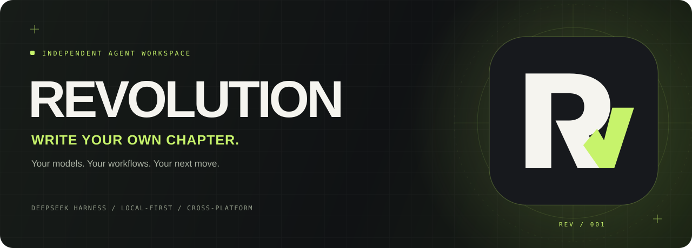

<div align="center">



**编写自之史章。**

以 DeepSeek Harness 为引擎，把想法变成可追溯的执行与交付。

[](https://github.com/zhiwenC125/plugins-general-dsh/actions/workflows/ci.yml)
[](https://github.com/zhiwenC125/plugins-general-dsh/actions/workflows/release.yml)


[**下载安装包 ↗**](https://github.com/zhiwenC125/plugins-general-dsh/releases) · [**体验设计 ↗**](https://www.figma.com/design/J3MYi2TF0UFcnzS86kZ2u3?node-id=27-968) · [**个人知识库 ↗**](docs/knowledge/README.md)

</div>

---

## 01 / 不止于一次对话

Revolution 是基于 [DeepSeek Harness](https://github.com/deepseek-ai/deepseek-harness) 的桌面工作空间，也可通过本地浏览器访问。它保留 DSH 的模型配置、工具、权限、插件与会话能力，在此之上构建自己的品牌和 Workflow 视图。

**模型负责思考，Harness 承载执行，Revolution 让过程可见。**

| 能力 | 你能得到什么 |
| --- | --- |
| **Bring your own API** | 配置自己的提供商、API Key 和模型 |
| **Workflow Studio** | 在会话的“对话”和“轨迹”之间，查看原生 Workflow 的阶段、成员与状态 |
| **Evidence, not decoration** | 从真实持久化事件和子会话读取运行事实，不伪造任务关系或产物 |
| **Desktop + local web** | Electron 桌面宿主与本地 Web，共用锁定的 DSH alpha5 运行时 |
| **Your own identity** | 原创 R/V 联字、荧光绿与光影拳头，属于 Revolution 的视觉语言 |
| **Build in the open** | 自动检查、三平台打包、校验和与人工确认的发布流程 |

> **Preview，坦诚地迭代。** 当前安装包未签名、未公证；真实 API 推理与跨平台 GUI 全流程仍需验收。Figma 的完整视觉与交互是产品设计目标，不代表每个页面都已逐像素实现。Jev 自动路由目前是研究方案，未接入运行时。

## 02 / 选择你的入口

### 直接使用

前往 [Releases](https://github.com/zhiwenC125/plugins-general-dsh/releases)，按设备选择安装包：

| 系统 | 架构 | 文件 |
| --- | --- | --- |
| macOS | Apple Silicon / ARM64 | `.dmg` 或 `-arm64-mac.zip` |
| Windows | x64 | `.exe` |
| Linux | x64 | `.AppImage` |

使用同平台的 `SHA256SUMS-*.txt` 核验文件。`Source code` 是源码，不是安装包；当前没有 Intel Mac 安装包。macOS 请将应用复制到 Applications，不要长期在只读 DMG 中运行，也不要全局关闭系统安全机制。

首次打开：**账号菜单 → 设置 → 模型 → 配置提供商与 API Key → 选择模型 → 开始任务**。协议支持以 DSH 原生设置为准，不承诺任意 API 地址都兼容。详见 [使用与发行指南](REVOLUTION_DESKTOP.md)。

### 从源码启动

建议使用 **Node.js 24 + npm**，从仓库根目录运行：

```sh
git clone https://github.com/zhiwenC125/plugins-general-dsh.git
cd plugins-general-dsh
npm run setup:revolution
npm run start:revolution
```

浏览器入口，完成 setup 后运行：

```sh
npm run web:revolution
```

打开终端输出的本地授权地址。服务仅监听 `127.0.0.1`；不要分享 URL 中的授权 token，也不要直接将端口暴露到公网。

<details>
<summary><strong>数据与凭据在哪里？</strong></summary>

默认数据目录为 `~/.revolution`，可通过 `REVOLUTION_HOME` 指定其他位置。首次启动使用专用 profile，不自动复制既有 DSH 设置。桌面安装包附带独立 Node 运行时，安装包用户无需另装开发用 Node。

模型请求仍会发送给你选择的提供商；“本地保存”不代表离线推理。API Key、会话、日志和工作区私人文件不要提交到 Git，也不要写进安装包或公开 CI 配置。

</details>

## 03 / 看清执行，不另造引擎

Workflow Studio 不是第二套编排器，而是 DSH 原生 `workflow` 工具执行事实的观察窗口。

- **阶段与成员**：展示运行分组、成员状态与子会话事实。
- **产物与交付**：文件类型标记、原生预览入口和需用户确认的导出清单。
- **真实边界**：`phase` 是进度分组，不等于严格 DAG；未记录的依赖不推测补画。
- **原生协同**：会话内嵌视图，没有另藏一个需要开启的独立设置开关。

无运行时，不展示虚构的运行。失败和中止，也应该作为事实被看见。

[插件说明](plugins/workflow-studio/README.md) · [兼容性与事件边界](WORKFLOW_COMPATIBILITY.md) · [开发交接](handoff.md)

## 04 / 从设计语言，到可复用界面

<div align="center">


&nbsp;&nbsp;&nbsp;&nbsp;


**CHARCOAL / IVORY / ELECTRIC LIME**

</div>

[Figma · Revolution Interactive v0.1](https://www.figma.com/design/J3MYi2TF0UFcnzS86kZ2u3?node-id=27-968) 包含 **18 个核心页面、245 处点击跳转、8 个主组件和 225 个实例**，以共享变量、明暗模式及按钮/导航变体支持复用。

进入 `02 · Revolution / Interactive v0.1`，选择首页后点击 Present，体验对话、Workflow、Agent 详情、导出、产物、设置与自动化的设计路径。

**原型不执行真实操作**：不会保存 API Key、重试 Agent 或创建定时任务。运行应用保留 DSH 原生设置逻辑，完整设计逐步落地。

[交互与复用指南](docs/knowledge/04-figma.md) · [审计记录](design/PROTOTYPE_STATE.md) · [生成脚本](design/figma-revolution-prototype.js)

## 05 / 一次提交，三种桌面

| 你做的事 | 自动发生的事 |
| --- | --- |
| 提交 PR / 推送 main 或 codex 分支 | 插件构建、语法检查、测试、生成文件一致性与版本校验 |
| 在 main 手动运行桌面构建 | 三平台打包 → 包内后端 smoke → SHA256 → 临时 Artifacts |
| 推送 `revolution-v*` 标签 | 三平台成功后创建附有安装包的 **Draft Release** |
| 人工检查后点击 Publish release | 公开现有附件；可标记为 Pre-release |

专用 `codex/release-preview/**` 分支也可触发预览打包。临时 Artifacts 保留三天，不控制 Release Assets 的保留时间。普通合并不会自动公开发布，重新运行预览分支任务也不会绕过 publish 的标签条件。

三个平台已有 [成功构建记录](https://github.com/zhiwenC125/plugins-general-dsh/actions/runs/38946301625)。检查验证的是包内后端启动、HTTP 与插件注册，不等于完整 GUI 或真实模型验收。

公开仓库标准 runner 是接近零成本的方案；仍需注意存储额度、付费 runner 和签名成本。完整操作、费用边界、发布复盘及本地 Git 冲突处理见 [CI/CD 个人手册](docs/knowledge/01-ci-cd.md)。

## 06 / 给开发者的地图

```text
apps/revolution/          Electron 宿主与独立 DSH runtime
plugins/workflow-studio/  真实 Workflow 事件投影与交付清单
plugins/revolution-brand/ 品牌插槽与主题覆盖
assets/                  原创品牌矢量资源
design/                  Figma 生成脚本与审计
scripts/                 构建、打包准备、版本及运行检查
.github/workflows/       自动检查与三平台发行
docs/knowledge/          可持续积累的个人知识库
```

```sh
npm run build                # 构建 Workflow Studio
npm run build:brand          # 构建品牌插件
npm run test:workflow        # Workflow 测试
node scripts/check-release.mjs

# 完成 setup 后，验证运行时或生成本机安装包
node scripts/smoke-runtime.mjs
npm run package:revolution
```

修改插件后，先运行对应构建，再执行 `node scripts/prepare-desktop.mjs` 同步到桌面依赖副本；仅启动应用不会自动同步改动。首页标题目前采用带数量校验的下游依赖文案覆盖，升级 DSH 时需要检查兼容性。

<details>
<summary><strong>旧 alpha4 源码路径（不是 Revolution 快速启动）</strong></summary>

原有 `npm start` / `dsh-studio` 依赖另行准备的 `deepseek-harness/` 源码副本与 `.dsh-smoke` profile，两者不在仓库内，新 clone 后不能直接使用旧命令。现有副本保留 alpha4 对照，桌面依赖则锁定 npm alpha5。

在已准备源码检出的环境中：

```sh
npm run setup
npm run build
npm run build:harness
npm start
npm run version:dsh
```

旧路径 setup 获取锁定的 pnpm，无需全局安装。`deepseek-harness/`、`.dsh-smoke/`、`.pnpm-store/` 均被忽略，不参与提交。涉及上游结构与版本时，先阅读 [探索文档](REVOLUTION_EXPLORATION.md)，不要误改另一套运行环境。

</details>

## 07 / 下一章

- [x] 独立桌面宿主、原生模型配置与本地 Web
- [x] Workflow 事实可视化、品牌与可点击核心原型
- [x] 三平台预览构建、校验和与草稿发布
- [ ] Figma 完整视觉在应用中逐项落地
- [ ] 取消/恢复与失败定位回归、产物溯源、预算和并发控制
- [ ] Jev 自动 Workflow 路由的影子评估
- [ ] GUI / 真实 API 验收、签名公证与安全更新

Jev 是结构化判断层的探索，不替代主 Agent，更不能绕过权限审批。当前没有启用向 Jev 外发用户 prompt 的功能。[阅读路由设计](docs/knowledge/03-jev-routing.md)

## 08 / 把经验留下来

[个人知识库](docs/knowledge/README.md) 从 CI/CD 到 Agent、DSH、Jev 和 Figma，把一次次开发变成可复用的方法，而不只是一次成功的截图。

Revolution 基于 DeepSeek 团队原生开发的 Harness，是独立下游项目，非 DeepSeek 官方客户端。界面探索参考 [open-claude-ui](https://github.com/Caho1/open-claude-ui) 的布局思路；REV 标识与光影拳头为本项目原创资源。依赖与参考项目的使用、再分发仍需遵守各自许可证。

---

<div align="center">

**REVOLUTION**

*Write your own chapter.*

[下载](https://github.com/zhiwenC125/plugins-general-dsh/releases) · [设计](https://www.figma.com/design/J3MYi2TF0UFcnzS86kZ2u3?node-id=27-968) · [文档](docs/knowledge/README.md) · [反馈](https://github.com/zhiwenC125/plugins-general-dsh/issues)

</div>
