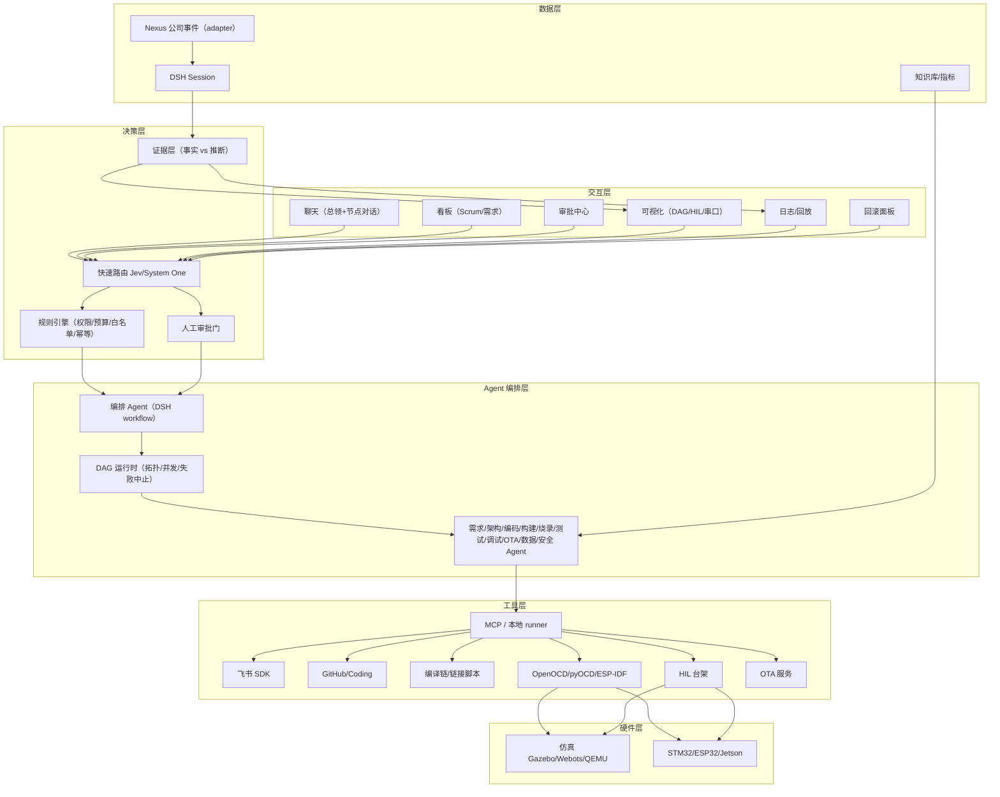
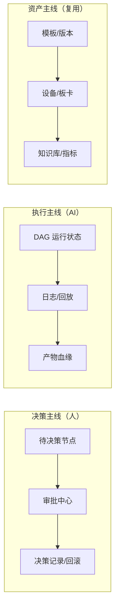
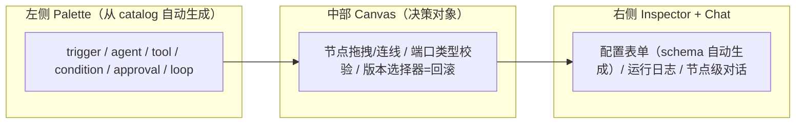

# 「人只做决策」——具身智能嵌软 AI 平台化样板间 · 深度洞察报告

> 生成日期：基于本地仓库 `dsh-ui-change`（git remote 实为 `ai-studio`，文档与 CI 均指向 `plugins-general-dsh`）考古。
> 结论：本仓库当前是「DSH 下游桌面工作空间 + Workflow 可视化」，**没有任何嵌入式/硬件/飞书/Scrum 实现代码**；但未跟踪的 ` 2` 草案文件暴露了「自动编排 DAG 运行器」的早期设计意图。

---

## 1. 执行摘要

**这个仓库是什么（事实）**：一个基于 DeepSeek Harness（DSH）的下游桌面工作空间 **Revolution**，唯一实质业务插件是 `workflow-studio`——把 DSH 原生 `workflow` 工具的执行事实投影成画布。全仓扫描确认：无 STM32/ESP32/Zephyr/RTOS/烧录/HIL/OTA/飞书 SDK/Scrum 看板代码。

**但藏着你的真实意图（考古核心发现）**：未跟踪的 ` 2` 文件里有一份更激进、更接近目标的草案——`README 2.md` 写「你只给初始输入（用户诉求、飞书纪要、GitHub / Coding 需求等），第一次输入即由 DSH 判断需要几个 Agent…生成 DAG，不需要人来决定是否产生 workflow」；`host 2.js` 实现了 `workflow_studio_catalog/ingest/plan/edit/run` 五个原生工具。**但它不完整：引用的 `graph.js`（DAG 校验）和 `runner.js`（DAG 执行器）不存在**，且 `handoff.md:224` 明确「不要恢复已经移除的插件内 DAG runner」——团队战略上主动从「自研编排器」退回到「只读忠实投影」。

**一句话结论**：你已有「模型编排 → 可观察执行」的上层壳，缺的是三层增量——**(1) 硬件/工具层**（编译/烧录/HIL/OTA 真实执行器）、**(2) 数据层**（把公司 Nexus agent 体系的持久化 DAG 用 adapter 接进来，`archive/WORKFLOW_COMPATIBILITY.md` 已写好规范）、**(3) 决策边界层**（把「只做决策」变成可审计的审批/规则引擎）。而 **workflow 是这三层的统一载体**（详见第 9 章）。

---

## 2. 仓库考古结果

### 2.1 现状盘点表

| 模块 | 作用 | 成熟度 | 证据 |
|---|---|---|---|
| Revolution 桌面宿主 | Electron 壳 + 内置 DSH alpha5 | 🟢 可运行（未签名） | `apps/revolution/main.cjs:10-22`；`apps/revolution/package.json:18` |
| Workflow Studio（当前版） | 只读投影 DSH 原生 workflow 事件 | 🟢 已实现+7 测试 | `src/projection.js:53-113`；`src/child-preview.js:22-58` |
| 导出清单 | 用户勾选 Agent 下载 manifest | 🟢 第一阶段 | `src/export-manifest.js:10-51` |
| 产物分类 | 按扩展名打类型标签 | 🟡 基础 | `src/artifact.js:1-9` |
| 品牌插件 | 主题/图标/sidebar | 🟢 已实现 | `plugins/revolution-brand/` |
| CI | 构建+测试+生成文件一致性 | 🟢 通过 | `.github/workflows/ci.yml:13-26` |
| CD 三平台打包 | mac/Win/Linux + draft release | 🟢 跑通 | `.github/workflows/release.yml:13-60`；`docs/knowledge/05-validation.md:5` |
| Smoke 测试 | 覆盖 workflow 全部脚本钩子 | 🟢 可用 | `workflow-smoke-test/script.js:4-74` |
| 知识库 | CI/Agent/Jev/Figma/验收 | 🟢 高质量 | `docs/knowledge/01~05` |
| Jev 路由 | 快速结构化路由设计 | 🔴 仅研究 | `docs/knowledge/03-jev-routing.md:7-12` |
| Nexus DAG 兼容规范 | 公司 agent→统一视图模型的 adapter | 🔴 纯契约 | `archive/WORKFLOW_COMPATIBILITY.md:83-134` |
| 自动编排 DAG 运行器 | 自研编排器（5 工具+ingest） | 🔴 残缺草案 | `src/host 2.js`；`README 2.md`；**缺 graph.js/runner.js** |

### 2.2 能力 / 缺口 / 技术债 / 自动化机会

- **现在能做**：三平台桌面 AI 工作台；workflow 全过程可视化/回放/导出；零成本 CI/CD 闭环。
- **缺口**：硬件层=0；Nexus adapter 有接口无实现；Jev 路由/审批流/权限矩阵只在文档；飞书/Scrum 仅存于文案。
- **技术债**：① 9 个未跟踪 ` 2` 冲突副本（iCloud 同步产生，与正本语义冲突）；② alpha4/alpha5 双运行环境并存；③ 构建产物 `lib/client.js` 入库；④ remote 指向 `ai-studio` 而非 `plugins-general-dsh`。
- **自动化机会（低垂果实）**：抢救 `ingest`（GitHub issue→简报）与 `catalog`（真实能力查询，防幻觉）两工具；补 `dshOutput/` 用户主动导出（`handoff.md:134-166` 已给结构）；建固定任务集回归。

---

## 3. 嵌入式工程师最佳体验洞察

### 3.1 用户画像

| 维度 | 嵌入式工程师（主） | 通用工程师（次） |
|---|---|---|
| 目标 | 让代码在真板子跑对、跑稳 | 快速上线、可维护 |
| 日常 | 看手册→写驱动→配寄存器→交叉编译→烧录→串口→HIL→OTA | 需求→编码→CI→测试→部署 |
| KPI | 点亮时间、缺陷逃逸率、MTTR、OTA 成功率 | 交付速度、自动化覆盖率 |
| 挫败点 | 环境半天搭不起、烧录口认不出、复位时序难复现、板子排队、串口乱码 | 上下文切换、重复脚手架、审批链长 |

### 3.2 价值主张 + 5 原则

> **一句话**：一条命令从需求到板子，中间只有决策需要你。

1. **可复现优先于聪明**：每次烧录/HIL 可完整重放（对齐 `archive/WORKFLOW_COMPATIBILITY.md:196` 的 append-only 可重放哲学）。
2. **硬件感知，低打扰**：板子是稀缺资源，预约→烧录→回收，异步通知不打断会话。
3. **事实与推断分界**：画布只画有持久化证据的边（`handoff.md:110-117` 铁律）。
4. **实时安全，fail-closed**：烧录/OTA/量产默认拒绝，未知事件版本降级不显示（`archive/WORKFLOW_COMPATIBILITY.md:258`）。
5. **决策最小化、审批可回滚**：人只在高风险点出现一次，每次审批可回滚。

### 3.3 体验地图（10 阶段）

| 阶段 | 痛点 | AI 可自动化 | 人类必须决策 |
|---|---|---|---|
| 需求 | 纪要/issue 散落 | 抓取→结构化简报+澄清 | 优先级、验收标准 |
| 架构 | 选型靠经验 | 生成 2-3 候选+权衡表 | **芯片/RTOS/通信栈选型** |
| 编码 | 手册冗长、样板多 | 生成驱动骨架/单测/DTS | 关键算法/安全逻辑 review |
| 交叉编译 | 工具链版本地狱 | 探测→生成环境→编译 | 工具链/链接脚本锁定 |
| 烧录 | 协议/驱动易错、量产风险 | 检测→选协议→执行+校验 | **量产板烧录审批** |
| 调试 | 复位/时序难复现 | 解析日志→根因假设 | 危险操作（改时钟/关看门狗） |
| HIL | 环境搭建重 | 生成用例→驱动仿真 I/O | **HIL 通过放行** |
| 测试 | 硬件测试慢、flaky | 生成/执行/判定 | 阈值定义 |
| OTA | 差分/回滚/签名复杂 | 差分包+灰度+监控 | **放量/回滚审批** |
| 维护 | 设备日志难采集 | 回流→根因→提 PR | 数据授权、方案选择 |

---

## 4. AI 平台架构（分层）



---

## 5. 人机决策边界表

| 决策 | 归属 | 依据 |
|---|---|---|
| 芯片/RTOS/通信栈选型 | 👤 人类 | 成本/供应链/经验 |
| 架构方案批准 | 👤 人类 | 长期可维护性 |
| 量产板烧录 | 👤 一次放行 + ⚙️ 白名单内自动 | 防变砖 |
| OTA 灰度/回滚 | 👤 人类 | 不可逆成本高 |
| 数据授权（飞书/设备数据外发） | 👤 人类 | 信息安全（`archive/WORKFLOW_COMPATIBILITY.md:201`） |
| 发布/撤回 Release | 👤 人类 | 现有 draft+publish 机制 |
| direct vs workflow 路由 | ⚡ Jev/System One | `03-jev-routing.md:7-12` |
| 工具/技能预筛、失败分类、模型路由 | ⚡ Jev/System One | 同文档小实验 |
| 权限/预算/幂等/白名单检查 | ⚙️ 规则引擎 | 「算预算用代码，不让模型猜」 |
| DAG 生成/代码生成/方案起草 | 🧠 大模型（人 review） | 生成性任务 |
| 烧录协议/工具链版本选择 | ⚙️ 规则引擎 | 确定性工程决策 |

> **Jev 边界**：只做结构化快速判断（<1.5s、带置信度），不生成、不授权、不执行。

---

## 6. 具身智能样板间蓝图（移动机器人）

**场景**：四轮差分移动底盘（STM32 底控 + ESP32 传感 + Jetson 上层 ROS2）。

端到端：需求 → 仿真(Gazebo/Webots) → 代码生成 → 交叉编译 → 烧录(OpenOCD/esptool) → HIL(编码器回注) → 测试 → OTA(差分包灰度) → 数据闭环(IMU/里程计/电机电流回流)。

```text
showroom/mobile-robot/
├── board/            # BSP: CMake/Kconfig/*.dts/*.ld
├── firmware/         # 底控/传感固件
├── ros2_ws/          # 上层节点
├── sim/              # 仿真世界与 launch
├── hil/              # 台架脚本、I/O 回注、断言
├── ota/              # 差分、灰度策略
├── agents/           # 各 Agent 的 workflow 脚本
├── .github/workflows/  # 编译+HIL+烧录流水线
├── demo.sh           # 一条命令端到端
└── dashboard/        # 指标看板
```

---

## 7. 路线图与指标

**MVP（1–4 周）**：飞书/issue → 需求 Agent → 编码 Agent（STM32 blink + 1 个 ROS2 节点）→ 本地编译 → 烧录（人工一键）→ 串口回显 → 画布。目标：**首次点亮 <30min**。

**平台化（5–8 周）**：架构/构建/烧录/测试/OTA Agent + Nexus adapter + 审批中心 + Jev shadow→上线。

**样板间与生态（9–10 周）**：模板、指标看板、`demo.sh`、参考架构文档。

| 指标 | MVP | 平台化 |
|---|---|---|
| 首次点亮 | <30min | <10min |
| 提交→HIL 通过 | <20min | <10min |
| 人工决策/需求 | ≤4 次 | ≤2 次 |
| 自动化覆盖率 | 75% | 90% |
| MTTR / 缺陷逃逸 | 建立基线 | ↓50% / ↓30% |
| OTA 成功率 | — | ≥99%，回滚 <5min |

---

## 8. 风险与优先级

**风险**：实时安全（变砖/时序）→ 默认拒绝+回滚+灰度；硬件依赖（板子稀缺）→ 预约+仿真优先；模型幻觉（错误寄存器）→ catalog+规则引擎兜底；成本 → 公开 runner+模型路由；合规 → 敏感数据留公司环境；上游协议变更 → adapter 隔离。

**优先级矩阵**：
- **P0**：抢救 ingest/catalog 工具；本地编译+烧录 runner；审批中心+决策边界固化。
- **P1**：Nexus adapter；HIL 台架；Jev 路由；OTA 差分灰度。
- **P2**：飞书 SDK；Scrum 看板；模板市场。

---

## 9. workflow 的战略定位 + UI 设计（新增核心章节）

### 9.1 workflow 不只是「视图」，而是平台的统一载体

在「人只做决策」的平台里，workflow 同时承担三个身份：

| 身份 | 含义 | 对应 UI |
|---|---|---|
| **决策载体** | 人审的不是 50 处代码改动，而是**一张 DAG 计划**（节点=Agent、边=数据流、每个节点带任务/角色/工具/技能/预期产物） | 画布上的「待你决策」节点 |
| **执行合同** | 节点预期产物 = 验收标准；Scrum story ↔ workflow plan 一一对应 | 看板列 = 节点状态聚合 |
| **证据链** | append-only 可回放事件 = 安全合规审计（谁用哪个工具链构建哪个固件、烧到哪块板、HIL 过没过、OTA 灰度到哪） | 日志/回放/产物血缘 |

由此衍生出 workflow 在嵌软平台里的 **8 个具体作用**：

1. **硬件流水线的编排骨架**：需求→编译→烧录→HIL→OTA 天然是 DAG。`parallel` 可跨目标并行编译、`pipeline` 串起「构建产物→烧录输入」。
2. **失败隔离 = 安全属性**：fail-stops-downstream 意味着「编译失败就不烧录」「HIL 不过就不 OTA」，这不是 UX，是防止带病固件上板的硬约束。
3. **审批与澄清的挂载点**：架构审批、烧录放行、OTA 灰度 = 画布上的 **gateway 节点**，卡住等待人类输入（`README 2.md` 的 systemPrompt 已设计「信息不足先建澄清节点」）。
4. **可复现实验单元**：`run-id + 工具链版本 + 板子 + 事件` = 一次可复现的构建/烧录/测试证据，直接服务「可复现」原则。
5. **版本化资产（模板市场）**：从「模型每次临时生成的编排」升级为「可版本、可复用、可分享的 plan 模板」，plan revision + 版本选择器是回滚的入口。
6. **数据闭环触发器**：OTA → 数据回流 → 异常 → 调试 Agent → 修复 → 回归，就是一个**自动触发的新 workflow run**。
7. **Jev 路由的升级路径**：路由器决定 `direct / workflow / clarify`，workflow 就是「可拆解、值得多 Agent 协调」的那条路——它是平台从「问答」到「工程执行」的分水岭。
8. **团队协作的合同面**：4 人团队 + Scrum 下，workflow 把「谁做什么、产出什么、验收标准」变成可见契约，天然对齐看板。

### 9.2 当前约束与解锁路径

当前原生 DSH workflow 事件**只有父子调用关系，没有 DAG 依赖边**（`archive/WORKFLOW_COMPATIBILITY.md:24-43`），所以画布只能忠实投影，不能画数据流。要让 workflow 承担上面的角色，只有两条路：

- **路径 A（改上游）**：扩展 DSH Runtime 持久化稳定 node ID、依赖边、artifact 引用（`handoff.md:122-132` 已列协议字段）。
- **路径 B（接 Nexus，不动上游）**：按 `archive/WORKFLOW_COMPATIBILITY.md:143-202` 定义 `nexus-workflow/v1/*` 事件，写 `adapters/nexus-dag.js`，把公司已有 DAG 投影到同一规范化模型。

**建议**：先走路径 B（零上游改动、复用公司资产、契约已就绪），路径 A 作为长期提案与上游共建。

### 9.3 workflow-first 的 UI 设计（信息架构主线）

**核心翻转**：DSH 现状是「聊天优先」（对话 → 工作流 → 轨迹）；「人只做决策」的平台应改为 **workflow-first，chat-as-input**——画布是决策对象，聊天降级为「总领输入框」。这正是 ` 2` 草案的方向（左侧画布 + 右侧约 1/3 原生聊天，ComfyUI 风格进度条）。

**三条信息架构主线**：



**七条具体 UI 落地原则**：

1. **画布即决策台**：节点是点击单元；状态「待澄清/待审批/运行中/完成/失败/已中断」用**颜色+文本+形状三重编码**（`archive/REVOLUTION_EXPLORATION.md:77`）。
2. **审批与澄清是一等状态**：画布上高亮「待你决策」节点，而不是埋在聊天里等用户发现（`archive/REVOLUTION_EXPLORATION.md:33`）。
3. **聊天分层化**：全图输入框（总领）＋ 节点级对话（针对单 Agent 补充，变更波及下游）＋ 澄清问答 ＋ 审批对话，四层上下文，而非一条扁平滚动流（`locales 2.js` 已有 `targetWorkflow/targetNode/chatPlaceholderNode` 文案）。
4. **版本即回滚**：plan 每次 edit 升 revision，画布顶部版本选择器 = 回滚入口。
5. **硬件面板常驻**：右侧或底部独立「设备面板」——板卡列表、串口监视器、HIL 波形、烧录进度，把「硬件感知」变成可见 UI。
6. **从会话到工作台**：首页（workspace home）把 Goals/Plans/Runs/Schedules/看板 提升为一等公民，会话降为「一次 run 的容器」。
7. **产物血缘可视化**：节点展开显示输入/输出/实际产物/工具调用轨迹，artifact 沿 DAG 边流转（依赖路径 A/B 的事件支持）。

### 9.4 建议的 UI 演进顺序

1. **先**：在现有 workflow-studio 上做「**待审批/待澄清状态节点**」（把 approval/questions 投影进画布）——这是「人只做决策」的最小可见落点，且不依赖上游协议。
2. **再**：实现 Nexus adapter + 数据流边，让画布真正画出「需求→…→OTA」的依赖。
3. **然后**：抢救 `ingest/catalog`，接入飞书/Coding 需求入口。
4. **最后**：workspace home + 看板 + 设备面板，完成「从聊天到工作台」的翻转。

---

## 10. workflow 节点化 + 可插入工具（n8n 化设计）

### 10.1 为什么 n8n 化是「人只做决策」的必然

n8n 的精髓不是「画流程图」，而是**把能力拆成可拖拽、可连线的节点，人负责编排，引擎负责执行**。落到本平台：

- **插工具 = 人划定 AI 的工具边界**：工程师把「编译 STM32」拖进图里，等于告诉 AI「这个环节只能这么干」——复用 `catalog` 的防幻觉逻辑（画布上的工具必须是注册过的，不允许 AI 凭空编）。
- **连线 = 人在结构层做决策**：人不需要审每个动作，只需要审「这个节点接那个节点」。审批、回滚、安全闸门全部变成图上的一类节点。

### 10.2 核心架构：一个统一 JSON DAG，三种执行方式

**不要造第二个编排引擎**（`handoff.md:224` 已定）。正确姿势：

```text
单一事实源 = 版本化 JSON DAG（可被人拖拽 + 可被模型生成）
   ├── Agent 节点  → 交给 DSH 子 agent
   ├── Tool 节点   → 调注册的工具（命令/MCP/脚本）
   └── Human 节点  → 审批门，卡住等输入
```

模型通过 `studio_node_plan` 写这个 JSON，人通过画布改这个 JSON——**人机共编同一份图**，这是 n8n 没有、本平台独有的优势。

### 10.3 节点注册契约（「插工具 = 注册工具」，零 UI 代码）

节点类型是**注册出来的，不是写死在前端**：

```js
registerNodeType({
  kind: 'tool',                    // tool | agent | condition | approval | trigger
  name: 'flash_stm32',
  title: '烧录 STM32',
  category: 'hardware',            // palette 分组
  params: {                        // 配置表单自动生成
    type: 'object',
    properties: { target: { type: 'string', enum: ['F407', 'F103'] } },
    required: ['target'],
  },
  inputs: { firmware: { type: 'artifact' } },
  outputs: { status: { type: 'status' } },
  run: async (inputs, ctx) => { /* 真正执行烧录 */ },
});
```

一旦注册，它就**自动出现在侧栏 palette、自动生成配置表单、自动做端口类型校验**。

### 10.4 节点分类

| 类型 | 含义 | 谁执行 |
|---|---|---|
| `trigger` | 飞书消息 / GitHub push / 设备事件 | 规则引擎 |
| `agent` | LLM 子任务 | DSH 子 agent |
| `tool` | 命令/MCP/脚本（编译、烧录、测试） | 本地 runner |
| `condition` | 规则判断（HIL 通过→OTA 否则→调试） | 规则引擎 |
| `approval` | 审批门（烧录放行、OTA 灰度、数据授权） | 👤 人类 |
| `loop` | 批处理（多板卡、多测试用例） | runner |

### 10.5 侧栏 palette UX + 三个第一等公民



**与 n8n 的三个差异点（产品护城河）**：① `approval` 审批门节点（n8n 没有）；② `agent` 节点（n8n 节点是确定性的，你的节点可以是 LLM 子 agent）；③ 模型共编（n8n 只能人拖，你的图能人拖 + 模型生成/修订）。

### 10.6 落地路径 + 本仓库实现入口

1. **第一步（1–2 周）**：命令节点 + 工具面板（palette 从 `catalog` 自动生成，支持编译/测试/烧录命令拖入画布、连线、运行）。
2. **第二步（2–3 周）**：`condition` 条件节点 + `approval` 审批门节点，把决策边界落到图上。
3. **第三步（后续）**：`graph.js`（图校验/拓扑）+ `runner.js`（统一调度三种节点），模型与人共编。

**已开始实现**：新建 `plugins/studio-nodes/` 插件，先交付**可单测的纯逻辑核心**——`src/registry.js`（节点注册契约 + 内置命令节点）、`src/graph.js`（版本化 JSON 图校验 + 拓扑分层，补回草案缺失的文件）、`src/runner.js`（拓扑执行器，失败即阻断下游）、`src/host.js`（`studio_node_catalog` / `studio_node_run` 两个原生工具）。浏览器侧 palette 画布为下一步。
