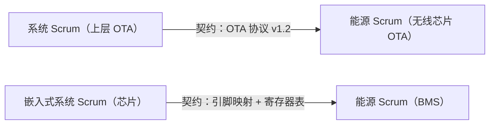
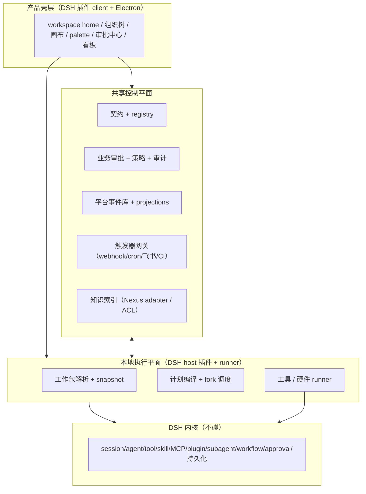

# 架构宪法 · 基于 DSH 的嵌入式工程 AI 平台

> 本文件是项目的**架构锚点**：所有「某功能做不做、放哪层、碰不碰 DSH 上游」的判断，一律对照本文。
> 本文收敛了多轮推演的最终结论，并取代 `docs/AI-PLATFORM-BLUEPRINT.md` 中偏早期的第 9/10 章定位。

| 元数据 | 值 |
|---|---|
| 状态 | **Draft / 待首个 ADR 批准** |
| 宪法版本 | 1.1 |
| 适用范围 | Revolution 下游产品、平台插件、共享协调服务、嵌入式 runner |
| 已核验基线 | 本仓库 DSH `0.2.1-alpha.4`；核验日期 2026-10-18 |
| 变更方式 | PR + ADR + 架构 owner 批准；禁止仅改实现、不改本文件 |

## 零、效力、优先级与用词

本文不是愿景清单，而是可被评审和测试的约束。关键词含义如下：

- **必须 / 禁止**：不可违反；如确需违反，必须走「架构例外」流程。
- **应该 / 不应该**：默认遵守；偏离时必须在 PR 中说明理由和风险。
- **可以**：可选实现，不构成兼容性承诺。

发生冲突时，优先级从高到低为：**人员与设备安全 > 数据安全与合规 > 可恢复性 > 正确性 > 兼容性 > 可用性 > 性能 > 交付速度**。任何“更智能”“更自动”的设计都不得越过这一顺序。

本文还强制区分三种陈述：

| 标签 | 含义 | 进入主干的证据要求 |
|---|---|---|
| **现状** | 仓库中已存在 | 路径 + 自动化测试或可重复命令 |
| **已验证** | 在目标环境跑通过 | 版本、环境、结果、证据链接/产物摘要 |
| **目标** | 尚未实现的架构决定 | owner、里程碑、验收标准 |

没有证据的“已有、支持、完成、可回放”一律按**目标**处理。

---

## 总纲：两个地基，一个循环

整个平台只建在**两个地基**上，其余全是地基上的建筑：

| 地基 | 是什么 | 一句话 |
|---|---|---|
| **DSH（内核）** | session / agent / tool / skill / MCP / plugin / subagent / workflow / approval | **执行的地基（跑）** |
| **可持续事实层** | 版本化事件、snapshot、workpackage、契约、决策、产物及其 provenance | **事实的地基（记住）** |

两者不是并排，而是一个**循环**：

```text
   ┌──────────────┐
   │  DSH（跑）     │
   └──────┬───────┘
          │ 执行 → 产出结果
          ▼
   ┌──────────────┐
   │ 数据（记住）   │  ← 沉淀成事实（版本化 / append-only / 可回放）
   └──────┬───────┘
          │ 事实 → 喂给下一次执行
          ▼
   （回到 DSH，再跑）
```

**每次有状态自动化的本质 = 「在 DSH/runner 执行 + 在权威源记录事实」。** 可复现、可回滚、可审计、跨 run 记忆、多人协作、数据闭环——全部立在这两个地基上。纯查询和 UI projection 不得反向制造领域事实。

---

## 一、产品定义（一句话）

> 在 DSH 内核之上，做一个**事件驱动、可触发、可复用、跨能力、有人审批的嵌入式工程编排层**。
> 组织（项目 → Scrum → 个人 → agent）被镜像成一棵**深度可变的递归树**，递归单元叫「**工作包**」；跨团队协作通过「**契约边**」传递；人只在高风险点做决策，且决策留痕。

---

## 二、内核 / 平台边界

先分**责任边界**，再决定进程和部署数量；“几个服务”不是宪法级不变量。

| 边界 | 内容 | owner | 约束 |
|---|---|---|---|
| **DSH 执行内核** | session、agent、tool、skill、MCP、subagent、原生 workflow、工具授权、Session 事件 | DeepSeek | 下游不 fork、不私改；只通过公开扩展点和 adapter 接入 |
| **本地执行平面** | 工作包解析、计划编译、runner 调度、工具适配、产物采集 | 平台团队 | 必须可离线降级；不得把长期共享事实只留在本机 |
| **共享控制平面** | 组织/身份映射、契约、业务审批、策略、事件索引、团队知识 | 平台团队 | 多租户隔离、审计、备份、迁移是上线前置条件 |
| **入口与外部适配** | webhook、cron、飞书、Git/CI、设备/HIL/OTA gateway | 集成团队 | 验签、限流、去重、最小权限；不承载领域真相 |
| **产品壳层** | workspace、组织树、画布、palette、审批中心、看板 | 产品团队 | 只投影事实；不得由 UI 状态反推或伪造执行事实 |

**判断规则**：

- 「单个 session 内 agent/tool 的执行与原生工具审批」优先复用 DSH。
- 「为何运行、运行什么版本、业务审批、跨 run/跨人共享、契约与产物血缘」归平台。
- DSH `approval/*` 是工具授权事实，**不等同于**发布、烧录、OTA 等业务审批；二者必须使用不同事件命名空间与策略。
- 新增常驻服务必须提交 ADR，证明它无法作为现有控制平面模块或外部 adapter 落地，并给出 owner、SLO、数据归属和退出方案。
- DSH 升级只能经 compatibility adapter；禁止让业务 schema 直接依赖 alpha 版本内部类型。

> 当前核验事实：DSH `0.2.1-alpha.4` 持久化 `tool-workflow/run-start`、`agent-start`、`agent-end`、`run-end`；没有持久化完整 pipeline/parallel 边、节点输入输出关系或 artifact 血缘。详见 `WORKFLOW_COMPATIBILITY.md`。

---

## 三、递归树：工作包是唯一递归单元

这不是固定 N 层的树，而是**深度可变**的递归树：

```text
工作包 = 接收需求 → fork 若干子工作包 → 产出产物
        （子工作包又是同样的结构……直到叶子）
```

工作包递归最终由 agent/tool 执行，但“组织层级”和“运行时委派深度”不是一回事；实现必须设置最大委派深度、最大节点数、最大并发与预算，避免递归失控。

| 项目形态 | 层数 |
|---|---|
| 一个人单干 | 1 层工作包 + agent |
| 小团队 | 项目 → 个人 → agent |
| 机器狗项目 | 项目 → Scrum → 个人 → agent（3 层工作包 + 1 层 agent）|
| 大公司 | 项目 → 部门 → Scrum → 小组 → 个人 → agent |

**术语对齐**：DSH 的「fork」= `subagent`（fork 独立上下文，不是 fork 内核）；「管道」= `pipeline()` 传文本 + 契约边传产物；「点进去对话」= `openChild` 打开子会话（`workflow-studio` 已实现）。

---

## 四、工作包定义：`workpackage.yaml`

`workpackage.yaml` 是声明式入口，不是唯一事实数据库。项目 / Scrum / 个人可以使用同一 schema，但**组织归属树**与**执行依赖图**必须分开：前者要求单父级且无环，后者允许 DAG，禁止把跨团队依赖伪装成 `children`。

```yaml
apiVersion: revolution.dsh/v1alpha1
kind: WorkPackage
metadata:
  id: wp_energy_scrum                         # 不可复用的稳定 ID，不用显示名作 ID
  name: 能源管理 Scrum
  revision: 7                                # 乐观并发控制；每次变更递增
  labels: { project: robotdog, criticality: high }
  owner: { role: energy-lead }
spec:
  parentId: wp_robotdog
  lifecycle: active                          # draft|active|suspended|retired
  repo:
    url: github.com/zhiwenC125/robotdog-energy.git
    ref: main
    commit: "0123456789abcdef0123456789abcdef01234567" # 必须解析并冻结为完整 SHA
  knowledgeRefs: [kb://robotdog/energy@12]
  contracts:
    inputs:
      - { id: contract_ota_protocol, range: ">=1.2 <2.0" }
      - { id: contract_chip_pinmap, range: ">=2.0 <3.0" }
    outputs:
      - { id: contract_wireless_ota, version: 1.0.0 }
  capabilities:
    skills: [bms-dev@3.1.0, ota-dev@2.0.1]
    tools: [bash-local@1, openocd@0.12.0]
    mcps: [coding-api@1]
  children: [wp_bms, wp_charger, wp_wireless_ota]
  policyRefs: [policy://embedded/high-risk@4]
  acceptanceRefs: [test://energy/contract-suite@9]
  budgets: { timeout: 2h, maxCostCny: 50, maxParallelism: 4 }
  execution: { retry: safe-only, concurrency: cancel-stale }
```

最小声明中必须存在：`apiVersion/kind`、稳定 ID、revision、owner、生命周期、冻结的代码版本、版本化能力、策略、验收和预算。`status` 不写回该声明文件，由 registry/controller 从事件计算并通过 API 返回（至少含 `observedRevision/phase/lastRunId`）。下面这种早期简写只可用于概念说明，不能进入生产 registry：

```yaml
id: energy-scrum
name: 能源管理 Scrum
owner: { role: energy-lead }                    # 决策归谁（多人视角的滤镜）
repo: github.com/zhiwenC125/robotdog-energy.git # 挂载的仓库
knowledge: ./knowledge/                          # 记忆（知识库）
contracts:                                       # 契约边
  inputs:
    - { name: ota-protocol, from: system-scrum, version: ">=1.2" }
    - { name: chip-pinmap,  from: system-scrum, version: ">=2.0" }
  outputs:
    - { name: wireless-ota, version: "1.0" }
capabilities:                                    # 能力包
  skills: [bms-dev, ota-dev, charger-dev]
  tools: [bash-local, openocd, feishu]
  mcps: [coding-api]
children: [bms, charger, wireless-ota]           # 子工作包（递归）
```

- **组织树** = 稳定 ID 之间的 `parentId/children` 关系；写入时校验引用存在、单父级、无环。
- **契约边** = `contracts.inputs/outputs` 的稳定 `id`、版本约束和解析后的 digest；producer 关系由 registry 解析。
- **决策** = `owner` 字段路由到人。
- **能力** = `skills` + `tools` + `mcps`（即 DSH 的 skill / MCP / tool，不是新概念）。
- **状态** = 期望态与观测态分离；manifest 只声明期望，controller 通过事件折叠出 `status`。
- 每次执行必须生成不可变 snapshot；运行中的工作包更新只影响新 run，不得悄悄改变旧 run。

---

## 五、契约边：跨 Scrum 的唯一可执行依赖原语

跨团队依赖 = 一条**带版本化契约产物的边**：



- 上游产出契约 → 写入契约库（版本化）→ 下游拉取 → AI 两侧照契约生成实现。
- 契约改版本 → 下游自动感知、重生成、回归。
- **架构集成 Scrum** = 契约的校验点，负责两侧集成测试。

### 契约发布的硬规则

契约不是一个版本号，而是一份不可变发布物。每个契约版本必须包含：稳定 `contractId`、SemVer、schema/IDL、内容摘要、producer owner、兼容性级别、支持窗口、弃用日期、示例、验证器和签名/来源。

- **patch**：只允许向后兼容的澄清或修复；不得改变已存在字段语义。
- **minor**：只允许向后兼容的增量；消费者必须通过兼容性测试。
- **major**：允许破坏性变更；必须有迁移计划、双写/双读窗口与明确下线日期。
- `latest`、浮动分支和未解析版本范围禁止进入执行 snapshot；调度前必须解析成确定版本和 digest。
- “自动感知”只产生 impact report 和候选迁移，不自动重生成并覆盖下游代码；任何落库改动仍走 diff、测试和风险策略。
- 契约发布必须通过 producer test、consumer-driven contract test 和集成测试；没有消费者验证证据不得标记 `stable`。
- 依赖图必须在写入时检测循环；确需双向协作时，以更高层共同契约或事件协议解耦。

---

## 六、组织镜像（机器狗完整映射）

```text
机器狗项目 workspace（= 项目工作包）
├── 嵌入式系统 Scrum     ← 工作包（能力包 + 仓库 + 知识 + agent）
├── 能源管理 Scrum       ← 工作包
│   ├── BMS 电池管理        ← 子工作包 + 仓库
│   ├── 充电桩              ← 子工作包 + 仓库
│   └── 无线通讯 + OTA      ← 子工作包 + 仓库（跨 Scrum：依赖系统 Scrum 的协议）
├── 嵌入式外设 Scrum
└── 架构集成 Scrum      ← 契约校验 + 集成验证
```

**一次需求怎么流（runtime 链路）**：

```text
1. PM 发需求「机器狗无线充电 OTA」
2. 工作包执行器读项目 manifest → fork 出 energy-scrum + system-scrum（subagent/session）
3. system-scrum 产出「OTA 协议 v1.2」→ 写入契约库
4. energy-scrum leader 拆需求 → fork 出个人工作包 wireless-ota
5. wireless-ota 拉契约 → 加载 ota-dev skill + 工具 → AI 生成实现 → 写回 repo → 跑测试
6. 架构集成 Scrum 拉两侧产物 → 集成测试 → 通过打 tag
7. 审批点按 owner 路由 → 飞书推送「待你决策」→ 留痕
```

---

## 七、人只做决策：审批门 + owner

「人只做决策」= 每个决策由对的人做、且被记录。**AI 做「可回滚、低风险、可建议」；人做「不可回滚、高风险、需问责」。**

| 决策 | 归属 |
|---|---|
| 芯片/RTOS 选型、架构方案、发布/回滚 | 👤 人类 |
| 量产板烧录、OTA 灰度、数据授权 | 👤 人类（owner） |
| direct vs workflow 路由、工具预筛、失败分类 | ⚡ 快速路由器（Jev/System One 仅为候选实现） |
| 权限/预算/幂等/工具白名单 | ⚙️ 规则引擎（代码） |
| DAG/代码/方案生成 | 🧠 大模型（人 review） |

模型或快速路由器的置信度不能授予权限。低置信度只能触发澄清、降级或人工决策；具体模型实现可替换，平台协议不得绑定 Jev。

审批节点是图上第一等公民，带 `owner`：

```js
registerNodeType({
  kind: 'approval', name: 'flash_release', title: '量产烧录放行',
  owner: { role: 'firmware-lead' },                      // 决策归属 → 路由
  decision: { approvedBy: 'zhang', reason: '…', at: '…' }, // 决策留痕
});
```

**反直觉但关键**：执行越自动化，决策治理越不能集中（四眼原则、问责）。

### 审批不是一个按钮

- `owner` 只负责路由，不能代替身份认证、权限校验和职责分离。授权必须由服务端根据 RBAC/ABAC、环境、风险和临时授权计算。
- 审批必须绑定 `subjectDigest`：代码 commit、workflow snapshot、契约版本、设备集合、固件摘要、目标环境和策略版本中任何一项变化，旧审批立即失效。
- 审批记录至少包含 `approvalId`、请求者、审批者、代理关系、决定、理由、时间、过期时间、策略版本和 subject digest。
- 高风险操作必须满足四眼原则；请求者、执行身份和最终审批者不得是同一主体。紧急 break-glass 必须限时、强审计、事后复核。
- 超时、身份服务不可用、策略不可解析、审计写入失败时一律 fail closed；只读展示可降级，危险执行不可降级。
- “人 review”不是质量门定义。每类审批必须列出人要判断的输入、可接受范围和拒绝后的状态转换。

---

## 八、节点化 + 可插入工具（n8n 化，但不造第二个引擎）

workflow 同时是三个身份：**决策载体**（人审 DAG 而非代码）、**执行合同**（节点=验收标准）、**证据链**（append-only 可回放 = 合规审计）。

**目标模型：统一 JSON DAG + 三种执行方式**：

```text
版本化 JSON DAG（人可拖拽 + 模型可生成）
   ├── Agent 节点  → DSH 子 agent
   ├── Tool 节点   → 注册的工具（命令/MCP/脚本）
   └── Human 节点  → 审批门
```

**节点类型**：`trigger`（webhook/cron/飞书/CI/设备事件）、`agent`、`tool`、`condition`、`approval`、`loop`。

**「插工具 = 注册工具」**，零 UI 代码：

```js
registerNodeType({
  kind: 'tool', name: 'flash_stm32', title: '烧录 STM32', category: 'hardware',
  params: { type: 'object', properties: { target: { type: 'string', enum: ['F407','F103'] } }, required: ['target'] },
  run: async (inputs, ctx) => { /* 执行烧录 */ },
});
```

目标是注册后自动出现在 palette、自动生成配置表单、自动端口校验。**截至核验基线尚未落地**：仓库中不存在 `plugins/studio-nodes/`；现有 `plugins/workflow-studio/` 是 DSH 原生 workflow 事件的只读投影，共 7 项测试通过。

### 计划、运行与投影三分离

| 对象 | 定义 | 能否驱动执行 |
|---|---|---|
| **Plan** | 经校验、版本化、待执行的 DAG snapshot | 可以，是唯一执行输入 |
| **Run events** | append-only 的实际状态变化与证据 | 可以恢复状态，不可改写历史 |
| **Projection** | 从事件构建的画布、看板、搜索索引 | 不可以，可随时删除重建 |

- UI 禁止把“推测出来的边”展示为事实边；推断信息必须显式标记 `inferred`，且永远不能成为自动执行依据。
- 当前 DSH 原生 workflow 事件不足以表达完整 DAG。平台若需要严格 DAG，必须定义自有命名空间（如 `revolution-workflow/v1/*`）并持久化 `plan-published`、`node-*`、`edge-declared`、`artifact-*` 等证据；不得篡改 `tool-workflow/*` 的语义。
- 节点注册必须包含参数 schema、输入/输出 schema、权限、风险等级、幂等策略、超时/重试/补偿策略和版本；仅有 `run()` 函数的节点不得进入生产 catalog。

---

## 九、多人视角：一个平台 + N 个镜头

**同一平台、同一棵组织树，`owner` 就是滤镜。** 一个 app 里三样东西：

| app 里的部分 | 是什么 | 职责 |
|---|---|---|
| **开发面** | 工作包树 + 画布 + palette + 能力包引用 | 干活 |
| **协作面（看板视图）** | 组织树 + 进度监控 + 审批中心 + 契约视图 | 统筹 / 决策 |
| **能力包目录** | skills/tools/MCP 的共享注册表 | 有哪些包可用 |

**部署模型**：本地执行平面 + 共享控制平面 + 外部事实源。

```text
每个人的本地 DSH（同一个 app）
├── 开发面（本地执行 + 联网）
│     连 → git（提交）+ CI/CD + LLM + 硬件 runner + MCP
└── 协作面（联网）
      连 → 共享控制平面（组织/契约/决策/策略/事件索引/知识）
```

| 权威源 | 内容 | 写入者 | 现状 |
|---|---|---|---|
| Git/制品库 | 源码、配置、构建产物、签名 | 开发/CI | 外部系统，需 adapter |
| DSH Session | 单 session 的对话、工具和原生 workflow 事实 | DSH | ✅ 已有，能力受当前事件 schema 限制 |
| 控制平面事件库 | 工作包、契约、业务审批、策略和平台 run 事件 | 平台服务 | ⬜ 目标 |
| 知识库 | 可检索知识及其来源、版本、权限 | 知识服务 | ⬜ 目标 |
| Projection store | 看板、搜索、统计和缓存 | projector | ⬜ 可丢弃重建，不是权威源 |

同一事实只能有一个 authoritative writer；其他系统以引用、事件或缓存消费。Git 与控制平面发生冲突时，按字段级权威表处理，不允许用“最后写入者胜出”掩盖冲突。协作面可以是本地 DSH 插件页面，但它只是控制平面的客户端，不能成为共享状态的唯一保存位置。

---

## 十、需求变更管理

新需求**不是看板手动加一行**，而是「AI 结构化 → 路由 → 挂树 → 审批」，看板自动刷新。

**六步链路**：需求进来（飞书/issue/PM）→ 需求 Agent 结构化 → 执行器路由（挂到哪棵子树，跨 Scrum 则生成契约边）→ 挂载（新节点或升版本）→ 审批 → 看板刷新。

**两种「加需求」**：

| 类型 | 动作 | 例子 |
|---|---|---|
| 新增 | 树上长新节点 → fork 新工作包 | 「充电桩支持 QC3.0」 |
| 变更 | 改现有节点 task/验收 → 版本 +1 → 影响下游 | 「OTA 协议 v1.2 → v1.3」 |

**原则**：需求历史 append-only + 版本化；纠错通过更正事件，撤销通过 tombstone。涉及个人信息、密钥、恶意内容或法定删除时，必须支持加密擦除/物理删除，同时保留不含敏感正文的审计证明。禁止把“append-only”误解为“任何数据永不删除”。

---

## 十一、可复现性：对抗非确定性的三件套

AI 生成天生非确定，解法不是「让 AI 确定」，而是「**生成一次 → 冻结 snapshot → 执行 snapshot；新推断产生新版本**」。Git commit 是其中一项，不是完整快照。

| 机制 | 作用 |
|---|---|
| **生成/执行分离** | AI 生成 → 校验/批准 → 冻结 snapshot；执行只读 snapshot |
| **增量 + 版本锁定** | 新增需求只长新节点，老节点锁死；升版本才重生成，diff 人 review |
| **契约锚点** | 跨团队两侧对同一个 frozen 契约生成，各自漂移也不破坏集成 |

每个 run 的 provenance manifest 至少冻结：

- plan/workpackage/contract/policy 的版本和内容摘要；
- repo commit、未提交补丁（生产禁止）和 submodule；
- 模型 provider/model/revision、系统提示词、采样参数和上下文摘要；
- skill/tool/MCP/plugin/runner 的版本与制品 digest；
- 容器/OS/编译器/SDK/lockfile、环境变量名清单（不记录 secret 值）；
- 输入数据集版本、知识引用、硬件型号/板卡 ID/固件/校准版本；
- 审批 subject digest、执行身份、时间源和随机种子（如适用）。

“可回放”分三级声明：**审计回放**（重建发生过什么）、**逻辑回放**（相同事件得到相同 projection）、**执行复现**（重新执行得到满足容差的结果）。任何功能必须写明支持哪一级，禁止笼统声称“可复现”。

**本质**：AI 输出在生成时是推断；只有经过 schema 校验、策略/审批并以不可变摘要持久化后，才成为可执行事实。系统可以基于事实发起新推断，但不得用新推断静默改写旧事实。

---

## 十二、落地架构：执行平面 / 控制平面 / 产品壳



**包结构**：

```text
dsh-ui-change/               # 当前仓库名；若迁移，目录结构语义保持不变
├── apps/revolution/          # 产品壳（已有）
├── plugins/
│   ├── workflow-studio/      # 画布（已有）
│   ├── studio-nodes/         # 节点注册 + 图模型（目标，尚未创建）
│   ├── workpackage/          # ← manifest 规范 + 加载器 + 递归执行器
│   ├── contract-hub/         # ← 契约库 + 版本管理
│   ├── approval-hub/         # ← owner 路由 + 决策留痕
│   ├── scrum-board/          # ← 协作面页面（fetch 协调服务器）
│   └── feishu-trigger/       # ← 飞书触发器
├── services/                 # 逻辑模块；是否拆进程由 ADR 决定
│   ├── control-plane/        # registry/契约/业务审批/策略/事件
│   ├── trigger-gateway/      # webhook/cron/CI 网关
│   └── knowledge/            # 跨 run 知识索引（Nexus adapter）
└── docs/knowledge/           # 知识库（已有）
```

**三刀落地顺序**：

1. **第零刀（事实地基）**：事件 envelope、稳定 ID、snapshot/provenance、状态机、幂等键和 projection 重建测试。没有这一刀，后三刀只会制造不可审计的演示。
2. **第一刀（单机闭环）**：`workpackage/` —— 一个工作包在固定 snapshot 上完成 agent → tool → artifact → 验收，故障后可恢复。
3. **第二刀（跨团队）**：`contract-hub/` —— 契约发布、兼容检查、影响分析、消费者验证真实闭环。
4. **第三刀（受控自动化）**：`approval-hub/` + `scrum-board/` —— 权限、策略、digest-bound 审批、四眼原则、审计与协作投影。

---

## 十三、已落地资产 + 路线图

| 资产 | 路径 | 状态 |
|---|---|---|
| 产品壳（Electron；内嵌 DSH 源码基线为 `0.2.1-alpha.4`） | `apps/revolution/`、`deepseek-harness/` | ✅ 已有，版本表述以 package metadata 为准 |
| Workflow 画布（只读投影） | `plugins/workflow-studio/` | ✅ 已有 |
| Workflow Studio 自动化测试 | `plugins/workflow-studio/tests/` | ✅ 7 项通过（2026-10-18 核验） |
| 节点注册/图模型/执行器 | `plugins/studio-nodes/` | ⬜ 目标；目录尚不存在 |
| 契约库/工作包/审批/看板/触发器 | `plugins/{contract-hub,workpackage,approval-hub,scrum-board,feishu-trigger}/` | ⬜ 待建（三刀） |
| 产品+体验洞察报告 | `docs/AI-PLATFORM-BLUEPRINT.md` | ✅ 已有 |
| 本宪法 | `docs/ARCHITECTURE-CONSTITUTION.md` | ✅ 本文 |

**路线图假设（2.5 个月 / 4 人，批准前必须完成容量评估）**：

| 阶段 | 内容 | 验证指标 |
|---|---|---|
| MVP（1–4 周） | 第零刀 + 单工作包确定性闭环 | 恢复测试通过；projection 可重建；首次点亮指标建立基线 |
| 平台化（5–8 周） | 契约库 + digest-bound 审批 + 看板；Nexus adapter shadow | 契约兼容门禁；高风险动作 100% 有审计；提交→HIL 建立 p50/p95 |
| 样板间+生态（9–10 周） | 机器狗模板、指标看板、demo、参考架构 | 在固定样本集上报告成功率、p50/p95、失败分类和回滚时间 |

`<30min`、`90%`、`OTA ≥99%` 等数字在没有样本定义、时间窗和基线前只能是目标，不能作为已承诺 SLO。指标必须注明分母、环境、排除项、p50/p95/p99 和错误预算。

**风险**：实时安全（变砖/时序）→ 默认拒绝+回滚+灰度；硬件依赖 → 预约+仿真优先；模型幻觉 → catalog 查询真实能力+规则引擎兜底；上游协议变更 → adapter 隔离；控制平面故障 → 本地安全停止/只读降级；供应链污染 → 固定 digest、SBOM、签名与隔离执行。

---

## 十四、事件、状态机与一致性

平台不承诺分布式 exactly-once。统一采用 **at-least-once 投递 + 幂等消费 + 可检测重复 + 可补偿副作用**。

### 统一事件 envelope

```json
{
  "eventId": "evt_01...",
  "eventType": "revolution-workpackage/v1/run-started",
  "occurredAt": "2026-10-18T08:00:00.000Z",
  "recordedAt": "2026-10-18T08:00:00.120Z",
  "tenantId": "tenant_robotics",
  "aggregateType": "workpackage-run",
  "aggregateId": "run_01...",
  "aggregateRevision": 12,
  "correlationId": "req_01...",
  "causationId": "evt_00...",
  "actor": { "type": "service", "id": "runner_local_7" },
  "schemaVersion": 1,
  "idempotencyKey": "run_01...:start",
  "payload": {},
  "integrity": { "sha256": "..." }
}
```

硬规则：

- 同一 aggregate 的 `aggregateRevision` 必须单调递增；并发写冲突显式失败并重试，不使用静默 last-write-wins。
- 产生领域状态与发布事件必须使用 transactional outbox 或等价机制，禁止数据库已提交但事件丢失。
- consumer 必须按 `eventId/idempotencyKey` 去重；外部副作用要有幂等键或显式补偿步骤。
- 事件 schema 只可向后兼容演进；破坏性变化发布新命名空间版本，并保留迁移器和回放测试。
- `occurredAt` 只用于展示业务时间，排序以 revision/因果关系为准，不能假设分布式时钟完全一致。

核心状态机必须在代码和文档中同源定义，至少覆盖：

```text
WorkPackage: draft → active → suspended → retired
Run: queued → admitted → running → {succeeded | failed | cancelled | timed_out}
Approval: requested → {approved | rejected | expired | revoked | superseded}
Contract: draft → candidate → stable → deprecated → retired
Artifact: staged → verified → released → revoked
```

终态不得原地改写；恢复或重试创建新的 attempt，并通过 `supersedes/causedBy` 关联旧 attempt。

### 副作用与硬件租约

- 节点必须声明 `effect: none|reversible|irreversible`。只有 `none` 可默认自动重试；`reversible` 需要幂等键或补偿；`irreversible` 默认不重试且需要业务审批。
- cancel 不是删除：调度器停止新节点、向运行节点发送取消、等待宽限期后隔离；已发生副作用以事件保留。
- 板卡/HIL/串口/JTAG 等稀缺资源必须通过带 TTL、heartbeat 和 fencing token 的租约使用；过期持有者不能继续写设备。
- artifact 必须有稳定 ID、类型、digest、大小、存储位置、producer run/node/attempt、输入 lineage、验证状态、保留策略和敏感级别。事件中引用 artifact，禁止内嵌大文件或 secret。
- 对设备或外部系统的命令必须记录“意图”和“结果”两个事件；结果未知不能当作失败后直接重试，必须先 reconcile 外部真实状态。

## 十五、安全、租户与供应链

安全不是插件功能，而是每层默认属性：

- 所有请求和事件必须带 `tenantId`；缓存键、对象存储路径、搜索索引、日志和指标均按 tenant 隔离。跨租户访问默认拒绝并产生日志。
- agent 和 tool 使用短期、任务级身份；禁止共享个人 token，禁止把 secret 写入 manifest、prompt、事件、日志或产物正文。
- 外部输入（issue、飞书、网页、设备日志、仓库内容）一律视为不可信数据；prompt injection 不得改变策略、授权、工具白名单或审批要求。
- 工具执行默认 sandbox、最小网络出口、只读挂载；烧录/HIL/OTA runner 与普通代码执行隔离，设备访问采用显式租约。
- 进入 catalog 的 skill/tool/MCP/plugin 必须有来源、owner、版本、digest、权限声明、风险等级、SBOM/依赖扫描结果和撤销机制。
- 固件和发布产物必须可签名、可验证、可撤销；生产设备拒绝未知签名和降级版本，除非经过 break-glass 流程。
- 日志在写入前分类和脱敏；定义保留期、访问审计、导出和删除流程。知识检索必须继承源数据 ACL，不能因向量化而绕过权限。

最低威胁模型必须覆盖：恶意仓库内容、被污染依赖、越权工具调用、审批重放、事件伪造、跨租户泄漏、runner 被攻陷、固件回滚攻击和设备身份冒用。

## 十六、可靠性、可观测与灾难恢复

每个生产组件在上线前必须有 owner、SLO、容量假设、错误预算、告警、runbook、备份和恢复演练。至少观测：

- run 排队/执行/恢复的 p50、p95、p99，按失败类型统计成功率；
- tool/模型调用的延迟、成本、重试、限流和取消；
- 事件积压、重复、乱序、dead letter、projection lag；
- 审批等待/过期/失效，高风险操作审计覆盖率；
- runner/板卡占用、租约过期、烧录/HIL/OTA 成功率与回滚时间；
- 契约兼容失败和受影响消费者数量。

所有日志、trace、事件与产物通过 `correlationId/runId/nodeId/attemptId` 关联。监控和看板是 projection，不得成为业务真相。

必须定期验证：从备份恢复控制平面、从事件重建 projection、runner 断线重连、任务中断恢复、重复 webhook、审批服务不可用、模型不可用、制品库不可用和设备执行到一半失联。RPO/RTO 在容量评估后填写；未填写前不得宣称生产就绪。

## 十七、架构治理与例外

以下变化必须写 ADR：新增权威数据源/常驻服务、修改层边界、修改事件或契约兼容规则、新增高风险 tool、改变审批策略、引入跨租户能力、修改安全降级方式、偏离本文“必须/禁止”。

ADR 至少包含：背景、决定、备选方案、数据归属、安全/隐私影响、故障模式、迁移/回滚、可观测性、成本、owner、复审日期。架构例外还必须包含：违反条款、适用范围、补偿控制、到期日；例外到期默认失效，不能永久豁免。

宪法修改规则：

1. PR 中同时提供修改动机、影响分析和 conformance test 变化。
2. 架构 owner 与安全 owner 至少各一人批准；涉及设备/发布安全时加入领域 owner。
3. 破坏性变更必须给迁移窗口和回滚路径。
4. 每季度做一次“文档—代码事实核验”，自动更新资产表；无法验证的绿色状态降级为黄色/目标。

## 十八、合规检查清单（Definition of Done）

任何平台能力只有同时满足下列条件才算完成：

- [ ] 责任边界和 authoritative writer 唯一明确。
- [ ] schema 有版本、稳定 ID、兼容策略和校验器。
- [ ] plan/snapshot、事件、projection 三者分离。
- [ ] 状态机、失败终态、重试、取消、超时和补偿已定义。
- [ ] at-least-once 下的幂等、去重、乱序和恢复测试通过。
- [ ] 权限、租户隔离、secret、审计、数据保留和删除策略已验证。
- [ ] 高风险执行 fail closed，审批绑定 subject digest 且会失效。
- [ ] provenance 足以完成声明级别的回放/复现。
- [ ] 单测、契约测试、集成测试和至少一个真实故障演练有证据。
- [ ] SLO、指标分母、p50/p95、告警、runbook、owner 和回滚已就绪。
- [ ] 文档中的“现状/已验证/目标”与仓库事实一致。

未满足任一安全、审计、恢复相关条目时，只能标记为实验性能力，禁止连接生产设备或生产数据。
